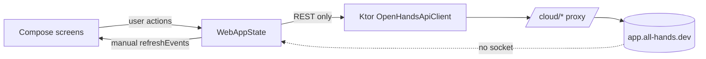

<!-- tm_board_write · 2026-10-15T13:55:48.675Z · role=researcher · session=20261015-165548 -->
# Canvas Coverage Audit — does ohaa cover everything the official canvas frontend does natively?

Date: 2026-10-15 · Audited by: researcher subagent · Read-only on both trees.
Sources: CANVAS = `/opt/openhands` (official TS frontend clone) · OURS = `/tmp/opencode/ohaa-kmp`.
Prior artifact read first: `/root/ohaa/.git/opencode-team/20261012-184705/openhands-frontend-research/01-general-research.md` (cited as **PRIOR §n**; claims taken from it, not re-opened here, are tagged [M]).

Confidence tags: **[H]** = line quoted in this audit, **[M]** = prior artifact or single grep-hit breadth, **[L]** = inference.

---

## 1. Canvas inventory (source: /opt/openhands)

### 1.1 Routes — 28 entries (`src/routes.ts:8-46`) [H]

| # | Route | File | Purpose |
|---|---|---|---|
| 1 | `/` (index) | routes/index-home.tsx | landing/home |
| 2 | `/conversations` | routes/home.tsx | conversation list (HomeScreen, home.tsx:11) |
| 3 | `/conversations/:id/panel` | routes/conversation-panel.tsx | same handlers as conversation (re-export, :1-3) |
| 4 | `/conversations/:id` | routes/conversation.tsx | conversation view |
| 5 | `/launch` | routes/launch.tsx | launch flow |
| 6 | `/customize` | routes/extensions-hub.tsx | extensions hub |
| 7 | `/skills` | routes/skills-settings.tsx | skills settings |
| 8 | `/plugins` | routes/skills-plugins.tsx | plugins |
| 9 | `/apps` | routes/canvas-extensions.tsx | canvas extensions (apps) |
| 10 | `/extensions/:name/*` | routes/canvas-extension-page.tsx | extension runtime page |
| 11 | `/mcp` | routes/mcp.tsx | MCP servers page |
| 12-21 | `/settings` + index, llm, agent, agents, condenser, agent-context, verification, app, secrets | routes/{settings-index,llm-settings,agent-settings,agent-profiles-settings,condenser-settings,agent-context-settings,verification-settings,app-settings,secrets-settings}.tsx | 9 settings screens |
| 22 | `/oauth/device/verify` | routes/device-verify.tsx | OAuth device flow |
| 23-27 | `/automations`, `/automations/git-sync`, `/automations/templates`, `/automations/new/:id`, `/automations/:id` | routes/automation*.tsx | automations product area |
| 28 | `/shared/conversations/:id` (outside layout) | routes/shared-conversation.tsx | public shared conversation |

### 1.2 Conversation view: chat + 7-tab drawer
- Chat is the main area; the right drawer holds tabs **files, commits, planner, terminal, browser, usage** — `conversation-tabs.tsx:86-142` [H]; **tasklist** is inserted conditionally at position 2 when a task list exists (`conversation-tabs.tsx:144-155`) [H]; lazy-loaded per tab in `conversation-tab-content.tsx:12-17` [H].
- Tab selection is persisted per conversation in localStorage (`conversation-tabs.tsx:58-67`) [H]; tabs can be pinned/unpinned (`:157-163`) [H].
- VSCode drawer link + terminal/commits icons imported at `conversation-tabs.tsx:4-12` [H].

### 1.3 API surface used by canvas (grep over src/, 166 hits in 59 files) [H for paths, line refs where quoted]
- **Rule**: agent-server calls go through `@openhands/typescript-client`, enforced by CI test `src/api/no-direct-agent-server-calls.test.ts` — PRIOR §2 [M].
- **Cloud app API** (bearer/cookie, app host): `/api/v1/app-conversations` (+ `/search`, `/{id}`, `/{id}/files`, `/{id}/file`, `/{id}/download`, `/start-tasks`) — `api/cloud/conversation-service.api.ts:159`; `/api/v1/sandboxes` + pause/resume — `api/cloud/sandbox-service.api.ts`; `/api/v1/secrets` (+ /search) — `api/cloud/secrets-service.api.ts:104`; `/api/v1/settings` (+agent-schema, conversation-schema) — `api/cloud/settings-service.api.ts:139,209,219,228`; `/api/v1/settings/profiles` — `api/cloud/profiles-service.api.ts:27`; `/api/organizations` + `/api/keys/current` — `api/cloud/organization-service.api.ts:50,74`; `/api/agent-profiles` — `api/cloud/agent-profiles-service.api.ts:27`; `/api/v1/git/{repositories,branches,installations}/search` — `api/cloud/git-service.api.ts`; `/api/v1/skills/search` + conversation skills — `api/cloud/skills-service.api.ts`; `/api/v1/config/{models,providers}/search` — `api/config-service/config-service.api.ts`; `/api/vscode/{url,status}` — `api/cloud/sandbox-service.api.ts`/utils/vscode-origin.ts.
- **Runtime / sandbox host** (X-Session-API-Key, proxied in cloud via `/api/cloud-proxy` — `api/event-service/event-service.api.ts` [H path], PRIOR §2 [M]): `/api/conversations/{id}/events`, `/events/count`, `/events/respond_to_confirmation` — `api/event-service/event-service.api.ts`; `/api/bash/execute_bash_command`, `/api/bash/bash_events/search`; `/api/file/{home,upload,download}` — `api/agent-server-home.ts`, `api/workspace-upload-path.ts`; `/api/git/{diff,commits}` + `/api/v1/app-conversations/{id}/git/{changes,diff}` — `api/git-service/agent-server-git-service.api.ts`; `/api/conversations/{id}/condense`; `/api/llm/balance`; `/api/llm/provider-connections`; `/api/llm/subscription/openai/device/*`; `/api/conversations/{id}/workspace/{file}`; `/api/canvas-extensions/*`; `/api/automation/v1/*`; `/api/auth/workspace-session`+ `/api/workspaces`.
- **Auth**: cloud Bearer or cookie (`authMode:'cookie'` → no header; `api/backend-registry/auth.ts:9-20` PRIOR §2 [M]); `POST /api/authenticate` — `api/main-app-auth.ts`; client-id headers `X-OpenHands-Client` — `api/client-source.ts` [M].

### 1.4 Live channel [H for existence, [M] for details from PRIOR §3]
- Events socket: `new WebSocket(...)` — `src/hooks/use-websocket.ts:56` [H]; bash socket `/sockets/bash-events` — `src/hooks/use-bash-command-runner.ts:78` [H]; URL `{ws|wss}://{host}{prefix}/sockets/events/{conversationId}` — `src/utils/websocket-url.ts:118-136` [M]; first frame `{type:"auth",session_api_key}` — `src/utils/websocket-auth.ts:1-17` [M]; subscribe `?resend_mode=since&after_timestamp=<newest REST ts>` after the first REST page — PRIOR §3.2 [M]; backoff 1→30 s + jitter, gated on first REST load — PRIOR §3.1 [M].
- **Event → UI mapping** (PRIOR §3.5, `conversation-websocket-context.tsx:551-700` [M]): error events → banner; ActionEvent → React-Query invalidation; ConversationStateUpdateEvent → execution_status + stats/metrics/goal stores; bash output → terminal store; browser screenshots → browser store; streaming deltas merged before non-delta events.
- **Send**: WS `{role, content, run:true}`, REST fallback `POST /api/conversations/{id}/events` — PRIOR §3.6 [M].
- **History**: REST `/events/search?limit=50&sort_order=TIMESTAMP_DESC` then reverse; scrollback `timestamp__lt` + page_id — PRIOR §3.3 [M].

### 1.5 List & shell features [H = dir listing]
- Conversation panel: pinned section, folders/groups, tags, archive/delete/stop/exit modals, layouts menu, budget display, skills/hooks/plugins modals, start-task cards, runtime-waiting state — `src/components/features/conversation-panel/` (48 entries) [H].
- Sidebar: conversation list, nav links, onboarding checklist, avatar — `src/components/features/sidebar/` (19 entries) [H].
- Home/launcher: repo/branch/provider/workspace dropdowns, open-repository/workspace dialogs, git-control-bar preview, featured automations — `src/components/features/home/` (15 entries) [H].
- Feature-area dirs incl. terminal/, browser/, diff-viewer/, chat/, markdown/, backends/, automations/, skills/, mcp-page/, settings/ — `src/components/features/` (29 entries) [H].

---

## 2. Ours inventory (/tmp/opencode/ohaa-kmp)

### 2.1 Screens
| File | Purpose |
|---|---|
| shared/.../ui/screens/DashboardScreen.kt | home: connection banner, templates, recent conversations (DashboardScreen:61) |
| shared/.../ui/screens/ConversationsScreen.kt | list + search + status filter (:56) |
| shared/.../ui/screens/NewTaskScreen.kt | prompt/repo/branch/templates/suggested tasks (:78) |
| shared/.../ui/screens/SettingsScreen.kt | API key, base URL, model, cloud profiles, secrets, local data (:87) |
| shared/.../ui/screens/ConversationScreen.kt | header + 5 tabs (:104) |
| app/src/main/java/com/example/ui/screens/{Dashboard,Conversations,NewTask,Settings,ConversationDetail}Screen.kt + OpenHandsViewModel.kt | Android-native copies (Room DB: data/local/*) |

Shared components: AgentProfileBadge, AgentProfileDialog, ProfileSummaryCard, TranscriptRenderers, CanvasPrimitives (shared/.../ui/components/).

### 2.2 Navigation — no router
- `web/.../Main.kt:78-81`: WebRoot renders ConversationHost when a conversation is selected, else a Scaffold with a 4-item NavigationBar (Main.kt:83-104); screen switch is a `when (state.tab)` over AppTab (Main.kt:108-197). No URL routing, no deep links, no back-stack.

### 2.3 Live behavior — none
- `grep -E "WebSocket|EventSource|ws://|wss://" **/*.kt` across OURS → **0 matches** [H]. No socket client anywhere.
- Web transcript = manual REST only: `WebAppState.refreshEvents()` → `api.searchEvents(id)` (WebAppState.kt:245-252), called on open (:240-243) and after send (:259); **no periodic poll** in :web (only launch polling: repeat(60)+delay(2000) at WebAppState.kt:217-234).
- Android polls every 10 s: `OpenHandsViewModel.kt:411` [H].
- Send = plain REST send-message then one refresh (WebAppState.kt:254-262; OpenHandsApiClient.kt:193) [H].

### 2.4 API clients
- **Web Ktor client — 25 calls** (OpenHandsApiClient.kt:96-322): health, users/me, billing/credits, app-conversations search/batch, events search, start-task create/get, send-message, rename, delete, files, file, git/changes, git/diff, skills, sandbox pause/resume/delete, git repos/branches/suggested-tasks, profiles list, secrets **list only**, templates. URL prefix `/cloud` (Main.kt:59), header `X-OpenHands-Key` (Main.kt:61).
- **Android Retrofit — 211 ops** in OpenHandsApiService.kt (lines 68-1217; grep `@(GET|POST|PUT|DELETE|PATCH)` = 211 matches) — full live spec.
- **Android runtime service — 23 ops** in AgentServerApiService.kt:42-182 (events POST/`respond_to_confirmation` :166, condense :124, interrupt :71, goal :91, fork :130, vscode url/status :175-179, workspace file :182); wired in OpenHandsRepository.kt:498-584.
- **:server** — one catch-all proxy `route("/cloud/{proxyPath...}")` (server/.../Server.kt:118) [H]; upstream target not re-read in this audit [M].
- Confirmation/VSCode DTOs exist in shared models (OpenHandsModels.kt:2033, 2088) but are **not called** from the web client [H].

### 2.5 Current data flow (ours)

---

## 3. Gap matrix
Legend: CANVAS evidence | OURS evidence | Status (FULL/PARTIAL/MISSING) | Size S/M/L | Priority.

| # | Feature | Canvas evidence | Ours evidence | Status | Size | Prio |
|---|---|---|---|---|---|---|
| R1 | Live event streaming | use-websocket.ts:56; websocket-url.ts:118-136 | 0 WS hits anywhere; WebAppState.kt:245-252 | MISSING | L | **P0** |
| R2 | Socket auth/replay/dedupe/backoff | websocket-auth.ts:1-17; PRIOR §3.1-3.2 | none | MISSING | M | **P0** |
| R3 | Event→UI side effects (status/metrics/terminal/browser) | conversation-websocket-context.tsx:551-700 [M] | none (events rendered as list only, WebAppState.kt:248-250) | MISSING | L | **P0** |
| R4 | Send via WS `run:true` + queue fallback | PRIOR §3.6 [M] | REST send only, WebAppState.kt:254-262 | PARTIAL | M | P1 |
| R5 | Confirmation respond (WAITING_INPUT) | event-service.api.ts respond_to_confirmation | WaitingForInputCard ConversationScreen.kt:509; no call in web client; Android repo:498 | PARTIAL | S | **P0** |
| R6 | History newest-first + reverse | PRIOR §3.3 [M] | OpenHandsApiClient.kt:150-160 | FULL | S | — |
| R7 | Scrollback pagination | use-load-older-events.ts:117-131 [M] | none | MISSING | M | P1 |
| R8 | Transcript render model (merge/deltas/drop think) | handle-event-for-ui.ts:14-64 [M] | TranscriptRenderers.kt; mapNotNull WebAppState.kt:249 | PARTIAL | M | P1 |
| R9 | Terminal tab (interactive bash + bash_events) | conversation-tabs.tsx:114-123; use-bash-command-runner.ts:78; bash-service.api.ts | TerminalTab renders agent events, ConversationScreen.kt:704 | PARTIAL | L | P1 |
| R10 | Files tab (tree, viewer, modes, open-in-window) | files-tab.tsx:170-233 | FilesTab list+content, ConversationScreen.kt:534 | PARTIAL | M | P1 |
| R11 | File upload/download | api/agent-server-home.ts, workspace-upload-path.ts; conversation-service.api.ts download | Retrofit has download (:181); web client none | MISSING (web) | M | P1 |
| R12 | Commits tab + per-commit diff viewer | commits-tab.tsx; diff-viewer/commit-list.tsx | ChangesTab git diff, ConversationScreen.kt:588-700 | PARTIAL | M | P2 |
| R13 | Planner tab + planning sub-socket | planner-tab.tsx; PRIOR §3.2 | none | MISSING | L | P2 |
| R14 | Browser tab (screenshots) | browser-tab.tsx; PRIOR §3.5 | none | MISSING | M | P2 |
| R15 | Task-list tab | task-list-tab.tsx; conversation-tabs.tsx:144-155 | none | MISSING | M | P2 |
| R16 | Usage panel + condense + provider balance | usage-tab.tsx; compact-context-button.tsx; provider-balance-card.tsx | UsageTab convo+skills, ConversationScreen.kt:746 | PARTIAL | M | P1 |
| R17 | Conversation skills (read) | hooks/query/use-conversation-skills.ts | OpenHandsApiClient.kt:257 | FULL | S | — |
| R18 | VSCode link/status | utils/vscode-origin.ts; conversation-tabs.tsx:12 | Android service :175-179; no web call/UI | PARTIAL | M | P1 |
| R19 | List search/filter | conversation-panel.tsx (/api/conversations/search) | ConversationsScreen.kt:56; WebAppState.kt:129-142 | PARTIAL | M | P1 |
| R20 | List pagination / infinite scroll | hide-older-conversations-row.tsx; PRIOR §4.3 | limit=50, no paging, OpenHandsApiClient.kt:115 | PARTIAL | M | P1 |
| R21 | Stop / archive / exit conversation | confirm-{stop,archive,exit}-modal.tsx | sandbox pause/delete only (WebAppState.kt:306-316); no stop/archive | PARTIAL | S | P1 |
| R22 | Pinned / tags / folders / layouts | conversation-panel-pinned-section.tsx; edit-conversation-tags-modal.tsx | none | MISSING | L | P2 |
| R23 | Budget display | budget-display.tsx; budget-progress-bar.tsx | global credits only, WebAppState.kt:105 | PARTIAL | S | P2 |
| R24 | Start-task async + poll | PRIOR §4.1 [M] | WebAppState.kt:209-238 (2 s × 60) | FULL | S | — |
| R25 | Launch: prompt/repo/branch/templates | features/home/* [H] | Main.kt:147-166; NewTaskScreen.kt:78 | FULL | S | — |
| R26 | Launch: workspace/provider dropdowns | git-provider-dropdown/, workspace-dropdown/ | none | MISSING | M | P1 |
| R27 | Templates + suggested tasks | home chat launcher; suggestions/ | WebAppState.kt:112-117 | FULL | S | — |
| R28 | Rename conversation | cloud PATCH [M] | OpenHandsApiClient.kt:201; ConversationScreen.kt:806 | FULL | S | — |
| R29 | Delete conversation | confirm-delete-modal.tsx | OpenHandsApiClient.kt:209; WebAppState.kt:144-151 | FULL | S | — |
| R30 | Sandbox pause/resume/delete | api/cloud/sandbox-service.api.ts | OpenHandsApiClient.kt:262-270; Main.kt:227-229 | FULL | S | — |
| R31 | Settings: key/base-URL/health | root.tsx backends [M] | SettingsScreen.kt:150-232; BrowserSession | FULL | S | — |
| R32 | Settings: secrets CRUD | secrets-service.ts:29,53,125 [M] | list only (OpenHandsApiClient.kt:310); AddSecretDialog has no call (SettingsScreen.kt:629) | PARTIAL | S | **P0** |
| R33 | Settings: LLM settings + schema forms | llm-settings.tsx; settings-service schemas | model text field only | PARTIAL | L | P1 |
| R34 | Settings: agent/condenser/verification/agent-context/app | routes.ts:24-34 | none | MISSING | L | P2 |
| R35 | Agent profiles (cloud CRUD + activate) | agent-profiles-settings.tsx; /api/agent-profiles | local AgentProfile (model only); cloud list (OpenHandsApiClient.kt:305) | PARTIAL | M | P1 |
| R36 | MCP page/settings | mcp.tsx; mcp-service.api.ts | none | MISSING | M | P2 |
| R37 | Skills marketplace/plugins/apps/extensions hub | routes.ts:18-23 | none (skills list only) | MISSING | L | P2 |
| R38 | Automations area (5 routes) | routes.ts:36-40; automation-service | none | MISSING | L | P1 |
| R39 | Shared conversation public view | routes.ts:42-45 | none | MISSING | M | P2 |
| R40 | Auth: backend registry/cookie/401 entry | backend-registry/auth.ts:9-20; root.tsx:17-45 [M] | single key+header, Main.kt:57-63 | PARTIAL | M | P1 |
| R41 | OAuth device flow | routes.ts:35; device-flow-client.ts | none (Retrofit parity only :1150-1159) | MISSING | S | P2 |
| R42 | Billing/subscription actions | billing/llm-subscription endpoints | credits number only | PARTIAL | M | P2 |
| R43 | Org/team surface | organization-service.api.ts (canvas UI thin) | none wired | MISSING | L | P2 |
| R44 | Onboarding checklist + APIs | sidebar-onboarding-checklist.tsx; /api/onboarding_status | none | MISSING | M | P2 |
| R45 | i18n + analytics | useTranslation throughout; /api/analytics/events | none | MISSING | S | P2 |
| R46 | Pending messages queue | mocks/conversation-handlers.ts (/pending-messages) | Retrofit :144 + Android repo:286; web none | PARTIAL | S | P2 |
| R47 | Provider connections / BYOR LLM keys | use-provider-connections.ts | none | MISSING | M | P2 |

---

## 4. Prioritized close-list (top 15)

1. **P0 — Native WebSocket event channel** (`{ws|wss}://{host}{prefix}/sockets/events/{id}`, auth frame, `resend_mode=since&after_timestamp`, backoff 1→30 s, id-dedupe). Target: new `shared/.../data/api/OpenHandsEventSocket.kt` + `WebAppState` wiring; :server must proxy the socket (today only the REST catch-all exists, Server.kt:118). Unblocks: live transcript, status, terminal/browser feeds.
2. **P0 — Event→UI side effects** (execution_status, stats/metrics, terminal lines, error banner). Target: `shared/.../ui/viewmodel/UiState.kt` + `TranscriptRenderers.kt`.
3. **P0 — Confirmation respond** (`POST /api/conversations/{id}/events/respond_to_confirmation`; DTO already exists, OpenHandsModels.kt:2033). Target: `OpenHandsApiClient.kt` + `WaitingForInputCard` (ConversationScreen.kt:509).
4. **P0 — Secrets write path** (add/update/delete) or remove the affordance. Target: `OpenHandsApiClient.kt` + `SettingsScreen.kt:629` — the dialog currently cannot succeed.
5. **P1 — Scrollback paging** (`timestamp__lt`/page_id, page size 50). Target: `OpenHandsApiClient.searchEvents` (:150) + chat list.
6. **P1 — Interactive terminal tab** (bash exec + bash_events) instead of the event-log view. Target: `ConversationScreen.kt:704` + new bash API calls.
7. **P1 — Files tree/viewer** (tree, syntax view, open-in-window) + upload/download. Target: `ConversationScreen.kt:534`.
8. **P1 — Usage panel parity** (context window, /condense, /api/llm/balance). Target: `ConversationScreen.kt:746` + client.
9. **P1 — VSCode link/status** for cloud conversations. Target: `ConversationScreen.kt` header; DTO exists (OpenHandsModels.kt:2088).
10. **P1 — List pagination + archive/stop** (and stop must stop a running conversation, not just pause the sandbox). Target: `ConversationsScreen.kt`, `OpenHandsApiClient.kt`.
11. **P1 — LLM settings + agent profiles CRUD** (schema-driven form from /settings/agent-schema; cloud /api/agent-profiles). Target: `SettingsScreen.kt`.
12. **P1 — Launch workspace/provider dropdowns** to match canvas home. Target: `NewTaskScreen.kt` + `Main.kt:147-166`.
13. **P1 — Auth/backends**: cookie mode, 401 entry screen, multi-backend registry. Target: `BrowserSession.kt`, `SettingsScreen.kt`.
14. **P2 — Conversation manager parity** (pinned/tags/folders/layouts, budget bars). Target: `ConversationsScreen.kt`.
15. **P2 — Whole canvas areas absent**: planner/browser/tasklist tabs, MCP page, extensions hub/plugins/apps, automations (5 routes), shared conversation view, org surface, device flow, onboarding checklist — schedule after P0/P1.

---

## 5. Not verified / gaps in this audit
- Canvas hook bodies cited via PRIOR arrows (PRIOR §3.x) were **not re-opened** here; tags [M]. Re-confirm before implementing R2/R4/R6/R7/R8.
- `/opt/openhands/src/api/cloud/conversation-service.api.ts` stop/archive endpoint: grep found only a comment (:244); exact cloud stop path **unverified** — modal presence is the only evidence for R21 stop.
- :server proxy upstream target not read (only the route, Server.kt:118) — socket proxying requirement for R1 is an inference [L].
- Android wiring depth beyond `OpenHandsRepository` method presence (respond/condense/vscode) not traced to UI [M].
- Node_modules typescript-client (local agent-server exact REST paths) not read — PRIOR §9 [M].
- No canvas screenshots inspected; "UI" claims are component-level, not pixel-level.

## 6. Counts
- Canvas screens/routes: **28** route entries (27 + 1 standalone) vs ours **5** shared screens (10 including Android-native duplicates).
- Conversation drawer tabs: canvas **7** (files, commits, planner, terminal, browser, usage, tasklist) vs ours **5** (chat, files, changes, terminal-log, usage).
- API: canvas touches **~45 distinct endpoint families across 59 files** (166 hits); ours covers the **211-op spec** in Retrofit (Android) but the **web client calls only 25** and the **Android runtime service holds 23 sandbox-host ops**.
- Matrix: **47 rows → 9 FULL, 18 PARTIAL, 20 MISSING**; priority: **5 P0, 16 P1, 17 P2** (P0/P1 all MISSING or PARTIAL).

*Board file written by tm_board_write (topic=canvas-coverage-audit). Requested paths /workspace/scratch/canvas-coverage/01-canvas-coverage-audit.md and /tmp/opencode/canvas-coverage/01-canvas-coverage-audit.md were NOT writable from the researcher tool surface (no write/edit/shell tools exist here) — blackboard is the only write channel; lead should copy it to both paths if required.*